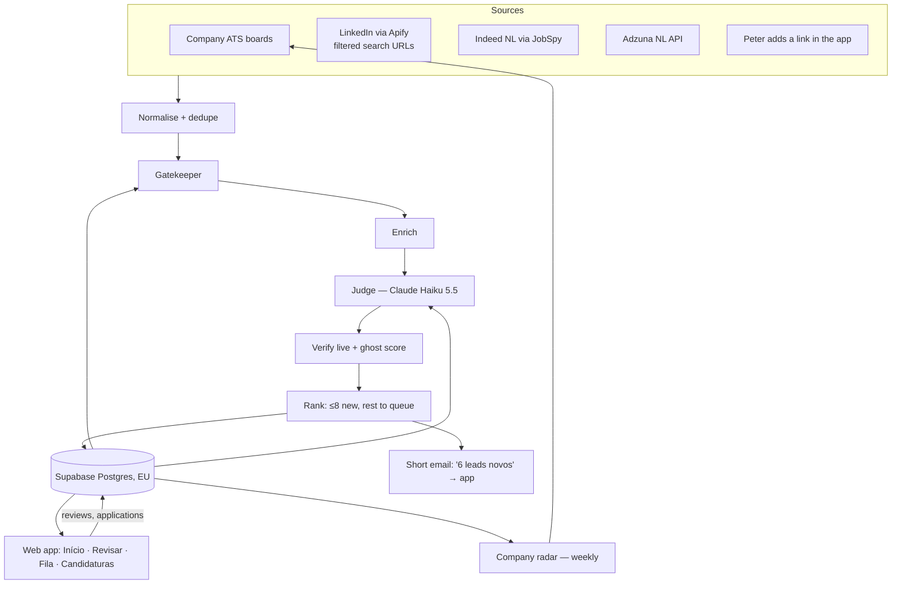

# Praia Job Radar — Architecture v3 (Netherlands only)

Build spec for Claude Code. Reuses the existing scanner code in `legacy/` (ATS fetchers in `scan.py`, `discover.py`, `add_from_links.parse_url`).

**One sentence:** Monday, Wednesday and Friday a pipeline collects Dutch job postings from LinkedIn, Indeed NL, Adzuna and companies' own career boards, drops what doesn't fit, has Claude read the rest against her profile, confirms each posting is real and open, and publishes them to a small private web app where she reviews new leads one at a time, keeps a short list, logs every application, and sees her week's progress.

**What changed since v2**
- **The app is the only place she logs anything.** The Google Sheet tracker is retired. The app tracks applications and their status, including ones she sent outside the app.
- **UI decided:** the look of option A (Maré) with the flow of option B (one lead at a time). Screens: Início, Revisar, Pronto, Fila, Candidaturas (§6). Mockups: `design/screens/` and `design/mockups/` (also the "Job Radar — 3 UI options" canvas, second row).
- **Progress mechanics from the praia move into the app:** weekly tide (applications vs target), sun streak with banked cloudy weeks, and "nãos corajosos" that count as progress.
- **Queue is one tap away** from every screen (tab bar + Início row), and leads expire from it quietly after 14 days.
- **Database in the EU.**
- **Gap fixes:** 30-day backfill on first run, Judge accuracy test before go-live, email-code login (not magic links) for the iPhone home-screen app, shutdown plan.

---

## 1. Non-goals

- No auto-applying. No logging into LinkedIn with anyone's account.
- No LLM browsing the web for jobs (§2, invariant 1).
- No jobs outside the Netherlands. Remote roles count only if open to NL residents.

## 2. Invariants

1. **Every job shown comes from a fetched source record with a URL.** Claude classifies and summarises; it never creates or "finds" a job.
2. **Nothing is published without a liveness check in the same run.**
3. **Find many, show few.** At most 8 new leads per run enter the review deck; everything else waits in the queue.
4. **Progress only goes up.** No screen shows a missed target, a broken streak or a rejection rate to her. Quiet weeks pause, never reset.
5. **Feedback labels data, never deletes it.** Every verdict can be undone.
6. **Spend is metered.** Paid sources switch off before the monthly cap.
7. **Thresholds and weights are YAML config, not code.**
8. **The pipeline's database key never reaches the browser.** The app uses only the public key, restricted by row-level security.

---

## 3. Overview



Pipeline: Python on GitHub Actions. Storage and login: Supabase, EU region. App: static site on Cloudflare Pages.

---

## 4. Pipeline components

### 4.1 Collectors

| Source | Method | Cost | Trust |
|---|---|---|---|
| Company ATS boards | existing fetchers from `legacy/scan.py` | free | highest — if it's here, it exists |
| LinkedIn | Apify LinkedIn-jobs actor, no login, pay-per-result, fed with **pre-filtered search URLs** (§8) | ~$1–2.30 / 1,000 results | medium |
| Indeed NL | `python-jobspy`, `site_name=["indeed"]`, `country_indeed="netherlands"`, `hours_old=72` | free | medium |
| Adzuna NL | official API, free developer key, country `nl`, `max_days_old=3` | free | medium |
| Peter's links | "+ add link" in Peter's view → `manual_links` table | free | always judged and verified, never gated out |

Every collector returns `RawJob {source, source_id, title, company, location, url, apply_url?, posted_at?, description?, salary?}`. A failing collector is logged and skipped.

**First run — backfill:** `run.py --backfill-days 30` once, so the app starts with the jobs already open instead of only the last 72 hours. Expect ~€1–2 of LinkedIn results for this run. Backfilled leads go to the queue; only the top 8 enter the first review deck.

### 4.2 Normalise + dedupe

- Company names: lowercase; strip `B.V.`, `N.V.`, `BV`, `GmbH`, `Ltd`, `Inc`, `Netherlands`, `Benelux`, punctuation.
- Location → NL city or `remote-NL`; anything else dropped.
- Merge key: normalised company + fuzzy title (`rapidfuzz.token_set_ratio ≥ 90`) + city.
- Canonical URL preference: company ATS > Adzuna-resolved > LinkedIn > Indeed. Keep all source URLs.
- ATS harvesting: run every `apply_url` through the URL parser ported from `legacy/add_from_links.py`; record discovered boards for the Company radar.
- Also match against `applications` (§7): a job she already applied to outside the app is never shown as a new lead.

### 4.3 Gatekeeper

1. Already seen, reviewed or applied → skip (update `last_seen`).
2. Location not NL → drop.
3. Title include/exclude lists → drop.
4. Posted > 21 days ago → drop.
5. Language recorded (`langdetect`), not used to drop.

### 4.4 Enricher

- Full description if missing; strip HTML; truncate to ~6,000 chars.
- Verified at source: if the company has a known ATS board, is this title on it?
- Hiring velocity: relevant postings from this company in the last 30 days.
- *(Phase 3, optional)* IND recognised-sponsor match, badge only.

### 4.5 Judge — Claude Haiku 5.5

One call per job that passed the Gatekeeper. Model `claude-haiku-5-5`, effort `low`. No sampling parameters, no assistant prefill (Haiku 5.5 rejects both). JSON only, validated against the schema, one retry, otherwise hold for the next run.

System prompt: `config/judge_prompt.md`. Input: `config/profile_brief.md` (provisional until she signs off on target roles — §17), her languages from `profile.yaml`, the job, and the last 15 review decisions with reasons as calibration examples (hers weighted over Peter's).

```json
{
  "relevant_function": true,
  "fit_score": 7,
  "seniority": "junior | mid | senior | lead | manager",
  "years_required": 3,
  "dutch": "required | preferred | none | unclear",
  "english_workplace": true,
  "work_mode": "onsite | hybrid | remote | unclear",
  "city": "Amsterdam",
  "right_to_work_required": true,
  "salary": {"min": null, "max": null, "period": "month | year | null"},
  "agency_posting": false,
  "ghost_signals": ["talent_pool", "evergreen_language", "vague_scope"],
  "reasons": ["max 3 items, each max 15 words, addressed to her, tied to her CV"],
  "watch_out": "max 20 words or null",
  "gaps": ["advanced SQL"]
}
```

`reasons` feed the "Por que combina com você" list on the review card, so each must cite something real from her CV.

**Accuracy test before go-live:** Peter labels ~30 real postings yes/no in `tests/gold_set.csv`. `run.py --eval` compares the Judge (`fit_score ≥ 6` = yes). Go live only at ~25/30 agreement or better; otherwise adjust `profile_brief.md` and re-run.

### 4.6 Verifier

**Tier 1 — every job with `fit_score ≥ 6`:** HTTP GET. Dead = 404/410, redirect to a generic careers/search page, or a closed phrase (`config/closed_phrases.yaml`, English and Dutch). Little visible text = `unknown`.

**Tier 2 — the ≤ 8 new leads plus anything `unknown`, max 20:** render with Playwright. Live only if the rendered text contains the job title (fuzzy) and no closed phrase → badge "Verificada hoje". Store hash and length of visible text.

**Queue re-check:** queue items older than 7 days are re-checked (tier 1) each run; dead ones leave the queue silently.

**Ghost score (0–5):** +2 known working ATS board but title not on it · +1 older than 30 days or reposted 2+ times in 30 days · +1 Judge ghost signals · +1 agency posting without named client · +2 company has 2+ "looks fake" verdicts. High (4–5) hidden unless verified at source.

### 4.7 Ranker + curator

```
score = fit_score × 10
      + freshness            (≤3 days +10, ≤7 days +5, >14 days −5)
      + verified_at_source   +8
      + multi_source         +3
      + hiring_velocity ≥ 3  +5
      + company_boost        +5 (she has applied there)
      + peter_recommended    +25
      − ghost_score × 5
      − 5 if dutch == "preferred"
```

Placement each run:

| Destination | Rule |
|---|---|
| **Review deck (new)** | top ≤ 8 by score with fit ≥ 6, live, dutch ≠ required, seniority not senior/lead/manager; max 2 per company |
| **Queue** | every other qualifying lead, plus `dutch == required` (tagged, filterable) |
| Not published | fit < 6, dead, ghost high and unverified |

Peter-recommended leads always enter the next review deck.

### 4.8 Company radar (weekly)

1. Seed: `companies.yaml`.
2. Companies with a job judged `fit ≥ 6` from an aggregator, or a harvested ATS link, get the probe ported from `legacy/discover.py` → added as `tier: auto`.
3. Activity per company over 30 days → "contratando ativamente" badge; none in 60 days → `dormant`, checked weekly.

---

## 5. Visa

```yaml
visa_mode: no_sponsorship_needed     # partner route — being confirmed with the IND
work_authorised_from: YYYY-MM-DD     # fill in once confirmed
languages: {pt: native, en: fluent, it: intermediate, nl: none}
```

- `right_to_work_required` is not penalised.
- If a JD needs a start date before `work_authorised_from`, it goes into `watch_out`.
- *(Phase 3, optional)* "on IND sponsor register" badge, information only.

---

## 6. Web app

### 6.1 Stack

- Static single-page app (Vite + TypeScript, Preact), `supabase-js`, on Cloudflare Pages. No server of our own.
- PWA: manifest + icon, installed via "Add to Home Screen". App name shown on her home screen: **Maré** (changeable).
- UI strings: `docs/DESIGN.md` is authoritative for all copy (Portuguese, "você"). Peter-only screens and controls are in English.
- **Login: Supabase email one-time code (6 digits), not magic links.** On iPhone a magic link opens in Safari, which doesn't share the login with the home-screen app, so she'd look logged out. Signups disabled; two allowlisted emails in `members` with `role = candidate | peter`. Sessions persist.
- First-open instruction: open the link in Safari, not inside WhatsApp, then Add to Home Screen.

### 6.2 Visual language (from option A)

| Token | Value |
|---|---|
| Ground | `#FFF8F4` |
| Surface / border | `#FFFFFF` / `#F1DFD8` |
| Ink / muted | `#3A2430` / `#6B5560` |
| Accent (primary actions, tide) | teal `#1F7A86`; tint `#E4F2F3` with text `#155E68` |
| Warm accent (Peter, "nãos corajosos") | `#A8355A`; tint `#FBEAE3`; warning text `#8A3350` |
| Display type | Instrument Serif (titles, big numbers) |
| UI type | Nunito Sans 400–800 |
| Radius | cards 16–24 px, buttons 12–16 px, chips full |
| Icons | inline stroke SVG; no emoji in the UI |

UI copy in Portuguese; job content as posted. Touch targets ≥ 44 px. Text contrast ≥ 4.5:1.

### 6.3 Screens (her view)

Tab bar on every main screen: **Início · Fila (count) · Candidaturas**.

**Início**
- Greeting + "Chegaram N leads novos desde sexta".
- **Maré da semana:** applications this week vs target (default 5), bar fills. Under it: sun streak ("4 semanas de sol") and "N nãos corajosos" this week.
- **Big button:** "Revisar N leads novos — um de cada vez · uns 5 minutos" → Revisar. Hidden when nothing is new.
- **Sua lista:** leads she chose with "Quero me candidatar", each with *Ver vaga* and *Candidatei*. Tapping *Candidatei* creates an application and fills the tide.
- **Fila · N leads esperando** row → Fila.

**Revisar** (one lead per screen)
- Segmented progress ("Lead 2 de 6"), *Sair* back to Início.
- Card: company · city · work mode; title in serif; badges (Verificada hoje, Peter indicou, há N dias, contratando ativamente, may be a ghost job); "Por que combina com você" (Judge `reasons`); one *Atenção* line; *Ler a vaga completa* link.
- Two big buttons: **Não é pra mim** · **Quero me candidatar** (→ Sua lista).
- Small: **Depois (fila)** · **Link morto** · **Parece fake**.
- "Não é pra mim" opens an optional one-tap reason sheet (too senior / wrong kind of role / Dutch needed / location / company / skip).

**Pronto por hoje** (after the last card)
- "Pronto por hoje." + counts: to your list / not for you / saved for later.
- Tide card with the shortlisted leads shown as the part of the bar still to fill: "As 2 que faltam já estão na sua lista."
- *Ver minha lista* → Início; *Revisar a fila (N)* → Fila.

**Fila**
- Every qualifying lead not in the deck or her list, newest/highest first. "Depois de 14 dias, saem sozinhos."
- *Revisar um de cada vez* → Revisar in queue mode.
- Filter chips: Todos · Peter indicou · Precisa de holandês.
- Each row opens the same card as Revisar.

**Candidaturas**
- Counters: enviadas · entrevistas · nãos corajosos.
- **"+ Registrar candidatura de fora do app":** paste a link (company and title guessed with `parse_url` + page title, editable) or type company + role.
- List with status chip; tapping a row changes status: *Enviada → Entrevista → Oferta*, or *Não (corajoso)*, or *Retirei*.
- Logging a rejection is a progress event: counter goes up, praia-style.

### 6.4 Progress mechanics (from the praia)

- **Tide:** applications created this ISO week / `weekly_target` (config, default 5).
- **Sun streak:** consecutive weeks with ≥ 3 applications. A week below 3 spends a banked cloudy week instead of resetting; one cloudy week refills each new week, max 2. The number never goes down.
- **Nãos corajosos:** applications moved to *Não*. Shown as an achievement, never as a rate.
- **Pronto por hoje:** finishing the review deck is itself a win, independent of outcomes.
- **The praia stays outside the app** (her decision). It remains a separate file she uses on her own; the app doesn't link to it, sync with it or replicate its beach.

### 6.5 Peter view (adds)

- ⭐ **Recomendar** on any lead → enters her next review deck with "Peter indicou".
- **+ Adicionar link** → `manual_links`.
- His "Não é pra mim" is advisory: her card shows "Peter: talvez não — reason". His *Link morto* / *Parece fake* hide the lead for both.
- **Health:** last runs, per-source fetched/kept/published, LinkedIn yield and cost per published lead, dead-report rate, verifier misses, spend vs budget, top "não é pra mim" reasons, Judge eval score, proposed YAML changes (applied by Peter editing YAML).

### 6.6 Nudge

After a run with ≥ 1 new lead: one email to her — subject `6 leads novos`, one sentence, one button to the app. No job list in the email. Nothing on quiet runs. Gmail SMTP with an app password from a dedicated account. Web push is a possible later upgrade.

---

## 7. Data — Supabase Postgres (EU region, e.g. Frankfurt)

```
members(user_id, email, role)
companies(id, name, norm_name, ats, slug, tier, status, ghost_flags, boost,
          ind_sponsor, first_seen, last_posting_seen)
jobs(id, canonical_url, company_id, title, city, work_mode, lang, posted_at,
     first_seen, last_seen, sources jsonb, judge jsonb, fit_score,
     ghost_score, verified_at_source, live_check jsonb, score,
     placement[deck|queue|none], state[new|judged|live|dead|published|archived],
     published_at, run_id)
reviews(id, job_id, user_id, decision[shortlist|later|not_for_me|dead|fake|recommend],
        reason, created_at, retracted bool)
applications(id, job_id null, company, title, url, origin[radar|external],
             status[sent|interview|offer|rejected|withdrawn],
             applied_at, status_changed_at, notes)
progress_settings(weekly_target, streak_min, cloudy_bank)
manual_links(id, url, title, added_by, created_at, processed_at)
domain_stats(domain, live_ok, verifier_misses, mode)
source_stats(run_id, source, fetched, gated, judged, published, dead_reported)
costs(run_id, source, units, usd)
runs(id, started_at, finished_at, status, notes)
```

Views: `my_week` (tide, streak, nãos corajosos), `deck_today`, `queue_open` (published, unreviewed or `later`, < 14 days, still live).

**Row-level security:**
- `jobs`: members `select` where `state = 'published'`. No client writes.
- `reviews`, `applications`, `manual_links`: members `insert`/`update` own rows (`user_id = auth.uid()`); `select` both members' rows. `applications` belong to the candidate; Peter can read and insert on her behalf.
- Health tables: `select` only for `role = 'peter'`.
- Pipeline: service-role key in GitHub Actions secrets only.

Free projects pause after 7 days without activity; three runs a week prevents that. If the pipeline can't reach Supabase, email Peter.

**Data residency:** database in an EU region. Static app files are served from Cloudflare's global network; they contain no personal data.

---

## 8. LinkedIn — paying only for relevant results

**How access works.** No LinkedIn account is involved — not hers, not Peter's. LinkedIn shows job search results publicly to logged-out visitors. A third-party "actor" on Apify opens that public search on Apify's servers, reads the results, and returns them as data. The pipeline calls the actor through Apify's API with an `APIFY_TOKEN`. Payment goes to Apify, never to LinkedIn.

**Account and payment.** Create an Apify account (Free plan: no credit card, $5 of usage per month). Each actor run is charged per result against that balance. On the Free plan, when the $5 is used up, Apify blocks runs until the next monthly cycle — so LinkedIn simply pauses and the pipeline continues on the free sources. Upgrade to Starter ($19/month, overage billed) only if LinkedIn turns out to be essential.

**Terms.** LinkedIn's terms prohibit automated collection. Because no account is used, the realistic consequence is the actor breaking or being blocked (§14), not anyone's profile being restricted.

Apify charges per result returned, so the levers below reduce results, not filter after paying.

1. **Feed search URLs.** Build the search on linkedin.com with Location *Netherlands*, Date posted (then set the URL's `f_TPR` to `r259200` = 72 h), Experience *Entry level, Associate, Mid-Senior*, Job type *Full-time*. Copy into `config/linkedin_searches.yaml`.
2. **Only new postings:** the 72 h window on a Mon/Wed/Fri schedule pays for postings since the last run, not the backlog.
3. **Two or three Boolean queries, not one per title**, so overlaps aren't paid twice:
   - `("sales operations" OR "revenue operations" OR revops OR "commercial operations" OR "sales analyst") NOT (intern OR internship OR director OR "head of" OR VP)`
   - `("salesforce administrator" OR "salesforce admin" OR "CRM analyst" OR "CRM specialist" OR "deal desk") NOT (intern OR internship OR director OR "head of")`
   - optional: `("business operations analyst" OR "pricing analyst" OR "GTM operations")`
4. **Calibrate first:** run each URL in the browser for "Past week", divide by ~2.3 for 72 h, set max results per search at ~1.5× that and a max charge per run (start at $0.30).
5. **Description in the same result:** choose an actor that returns the full description and apply URL, so no second paid lookup.
6. **Measure yield on Health:** share of LinkedIn results reaching fit ≥ 6 and cost per published lead. Under ~15% after two weeks → tighten.
7. **Kill switch:** `sources.yaml → linkedin.enabled` plus the monthly cap.

Final query terms wait for her sign-off on target roles (§17).

---

## 9. Costs — 3 months, ~39 runs + one backfill

| Item | Cost |
|---|---|
| Claude Haiku 5.5 (Judge + eval) | ~$0.50 usage (prepaid API balance, or included API credits if the Claude plan has them) |
| Apify LinkedIn incl. backfill | $0 on the Free plan (no card; LinkedIn pauses until the next cycle if the $5 monthly usage runs out). Starter $19/month only if LinkedIn proves essential |
| Indeed (JobSpy), Adzuna, ATS boards | $0 |
| GitHub Actions | $0 within free minutes |
| Supabase free tier (EU) | $0 |
| Cloudflare Pages | $0 |
| Gmail nudge | $0 |
| **Total cash** | **~€5 one-off** (a small Anthropic API top-up, of which ~€0.50 gets used). Add ~€50–55 only if Apify is upgraded to Starter for all 3 months |

Guardrail: `budget_eur_per_month: 6`; warn at 80%, disable paid collectors at 100%.

---

## 10. Platform

Claude Code + GitHub Actions + Supabase + Cloudflare Pages (decided in v2: ~€5 vs ~$75 for Replit Core over 3 months, no lock-in, existing Python code reused; identical experience for her).

---

## 11. Repo layout

```
radar/
  config/   profile.yaml  profile_brief.md  search_terms.yaml  scoring.yaml
            sources.yaml  linkedin_searches.yaml  closed_phrases.yaml  companies.yaml
  pipeline/ collectors/ (ats, linkedin_apify, indeed_jobspy, adzuna, manual)
            normalize.py gate.py enrich.py judge.py verify.py rank.py
            publish.py nudge.py company_radar.py costs.py db.py evaluate.py
  run.py    --fixtures --dry-run --no-publish --only <source> --limit N --backfill-days N --eval
            (--fixtures: read saved responses from tests/fixtures/ instead of calling sources)
  weekly.py
  supabase/ migrations/ (tables, views, RLS)  seed.sql (members, progress_settings)
  web/      Vite app: src/screens/{Inicio,Revisar,Pronto,Fila,Candidaturas,Health}
            public/manifest.webmanifest  icons/
  tests/    fixtures/ (one raw response per source)  gold_set.csv  test_*.py
  .github/workflows/  radar.yml (cron 37 6 * * 1,3,5)  weekly.yml
```

Secrets (GitHub Actions): `ANTHROPIC_API_KEY`, `APIFY_TOKEN`, `ADZUNA_APP_ID`, `ADZUNA_APP_KEY`, `SUPABASE_URL`, `SUPABASE_SERVICE_ROLE_KEY`, `GMAIL_USER`, `GMAIL_APP_PASSWORD`, `NUDGE_TO`, `ALERT_TO`.
Web app env (public): `SUPABASE_URL`, `SUPABASE_ANON_KEY`.

---

## 12. Run sequence

1. Read new reviews, applications and manual links.
2. Budget check.
3. Collect → normalise/dedupe → harvest ATS links.
4. Gatekeeper → Enrich → Judge (max 150 calls).
5. Verify tier 1 → rank → verify tier 2 for deck candidates → re-rank → place (deck / queue).
6. Re-check queue items older than 7 days; archive dead or > 14 days.
7. Publish in one transaction.
8. Nudge email if ≥ 1 new deck lead.
9. Write costs/stats. On any unhandled error: email Peter the traceback and publish nothing.

Weekly (Sunday): company radar; Health suggestions.

---

## 13. Build plan

**Phase 1 — usable within ~3–4 days.** Because the app is the only logging place, application logging ships in Phase 1.
- Supabase (EU) schema, views, RLS, two members.
- ATS + Indeed + Adzuna collectors → normalise/gate → Judge → Verifier tier 1 → rank/place → publish.
- `--eval` against Peter's gold set; go live only after it passes.
- App: email-code login; Início (tide, Revisar button, Sua lista, Fila row); Revisar (two big buttons + Depois/Link morto/Parece fake); Pronto; Fila (list + open card); Candidaturas (list, status change, register external application).
- Backfill run; GitHub Actions cron.
- LinkedIn via Apify once its URLs are calibrated (§8.4).
*Done when:* both of you log in on your phones; she reviews a deck end to end; an application logged from Sua lista and one registered from outside both appear in Candidaturas and move the tide.

**Phase 2 — week 2.** Streak with cloudy-week bank; reason sheet; Peter view (Recomendar, Adicionar link, Health); Verifier tier 2; ghost score; queue re-check/expiry; nudge email; error email; PWA polish.

**Phase 3 — week 3+.** Company radar; Judge calibration from reviews; Health suggestions; per-domain verifier modes; optional IND badge.

Don't start Phase 3 until she has applied to something the radar found.

---

## 14. Failure modes

| Failure | Detection | Response |
|---|---|---|
| Apify actor breaks | LinkedIn yields 0 twice | Health flag; swap actor (one file) |
| Apify Free usage used up | actor returns a usage-limit error | skip LinkedIn until the next cycle; Health shows "LinkedIn paused" |
| LinkedIn cost creeping | cost per published lead rising | tighten queries (§8); cap enforces itself |
| Supabase paused / unreachable | pipeline can't connect | error email; restore in dashboard |
| JS pages look empty | tier-1 `unknown` + Link morto reports | per-domain browser mode |
| Judge too generous | her "não é pra mim" rate > 50% | adjust `scoring.yaml`/profile; re-run `--eval` |
| Opened inside WhatsApp, login fails | — | first-open instruction (§6.1) |
| Queue grows into a guilt pile | queue > 30 | 14-day expiry; Fila copy stays "sem pressa"; consider lowering deck size |
| Deck too long | > 8 cards | impossible by design; tested |

## 15. Shutdown plan (once she's hired)

Pause the GitHub Actions workflows; disable Apify (or delete the token); revoke the Anthropic and Gmail app-password keys; export `applications` to CSV for her records; delete or pause the Supabase project.

---

## 16. Build sequence

Follow `docs/PROMPTS.md` step by step (steps 0–8 for Phase 1, then Phase 2 and 3). Each step has a "Done when" check. Respect the invariants in §2. When a source behaves differently from the spec, report it instead of working around it silently.

---

## 17. Open decisions

1. **Partner route (in progress):** confirm conditions and `work_authorised_from` with the IND or an immigration lawyer. Everything is NL-only because of this.
2. **Her target roles, cities, minimum salary (later):** until she signs off, `profile_brief.md` and the LinkedIn queries are provisional.
3. **CV header (outside the system):** once (1) is confirmed, add "Relocating to [city], Netherlands — right to work from [date]".
4. **Streak and "nãos corajosos" in the app vs. in the praia:** the praia stays outside the app, but the app has its own sun streak and rejection counter. Default: keep both. Remove them from the app if she'd rather the praia be the only place for those.
